# Clawd Stickers

English | [简体中文](README.zh-CN.md)

A collection of pixel-art animated stickers starring **Clawd**, the Claude Code mascot. Characters, props and frame-by-frame animation are drawn in Python, with ready-to-use GIFs included.

The collection currently contains **40 animated stickers** with the theme **Dev Life · 克码人生**.

Light and dark [clawd-on-desk themes](#desktop-pet-theme) are also included, bringing Clawd to your desktop with animations that follow Claude Code's working state.

> [!NOTE]
> This is an unofficial fan project, unaffiliated with and not endorsed by Anthropic. Content whose copyright is held by this project's contributors is [MIT-licensed](LICENSE) by default. Third-party rights, including the Claude Code mascot, are excluded.

## Contents

- [Features](#features)
- [Sticker preview](#sticker-preview)
- [Download and use](#download-and-use)
- [Desktop pet theme](#desktop-pet-theme)
- [Generate locally](#generate-locally)
- [Repository structure](#repository-structure)
- [Contributing](#contributing)
- [License and usage](#license-and-usage)
- [Credits](#credits)

## Features

- **Developer life and programmer jokes**: includes classics such as hello world, git clone and rubber duck debugging, alongside everyday scenes like slacking off, clocking out and bug hunting. There are also plenty of Claude Code references, including thinking, context compaction, usage limits and even a ban joke.
- **Consistent pixel style**: fan art based on Clawd's pixel design.
- **Ready-to-use GIFs**: every sticker is 288×288 with a transparent background and loops continuously. Download and use them directly, with no development environment needed.
- **Light and dark sets**: the dark set brightens text and outlines and darkens ground shadows for dark-mode chats.
- **Generated with code**: the Python script uses Pillow, with no extra fonts to download. Generate all stickers or selected ones locally.
- **Import into clawd-on-desk**: the stickers have been adapted into a dedicated theme for clawd-on-desk. Import it manually as a custom theme to replace the built-in one.

## Sticker preview

The collection currently includes 40 stickers with the theme **Dev Life · 克码人生**. See the [set guide](dev-life/README.md) for details.

<table>
  <tr><td align="center" width="20%"><b>hello, world</b></td><td align="center" width="20%"><b>Thinking</b></td><td align="center" width="20%"><b>ultrathink</b></td><td align="center" width="20%"><b>Plan Mode</b></td><td align="center" width="20%"><b>Todo List</b></td></tr>
  <tr><td align="center">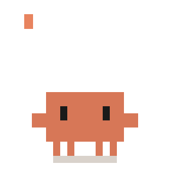</td><td align="center">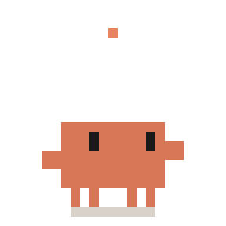</td><td align="center"></td><td align="center">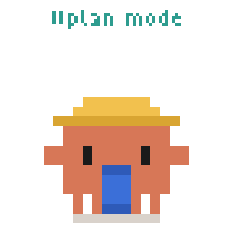</td><td align="center">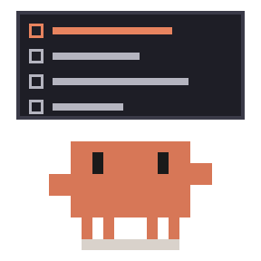</td></tr>
  <tr><td align="center" width="20%"><b>It's Simple</b></td><td align="center" width="20%"><b>Subagents</b></td><td align="center" width="20%"><b>Yes, Proceed</b></td><td align="center" width="20%"><b>LGTM</b></td><td align="center" width="20%"><b>You're Absolutely Right!</b></td></tr>
  <tr><td align="center">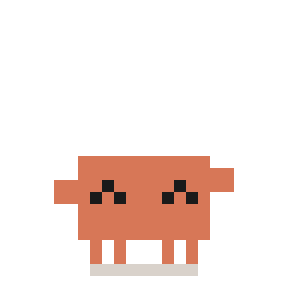</td><td align="center">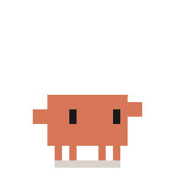</td><td align="center">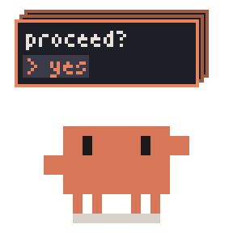</td><td align="center">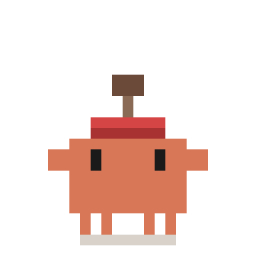</td><td align="center"></td></tr>
  <tr><td align="center" width="20%"><b>/compact</b></td><td align="center" width="20%"><b>/clear</b></td><td align="center" width="20%"><b>Usage Limit</b></td><td align="center" width="20%"><b>Esc</b></td><td align="center" width="20%"><b>Banned</b></td></tr>
  <tr><td align="center"></td><td align="center">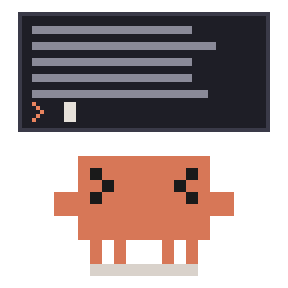</td><td align="center">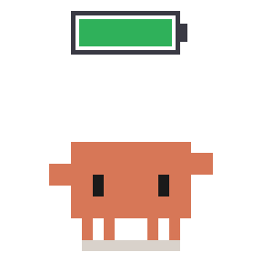</td><td align="center">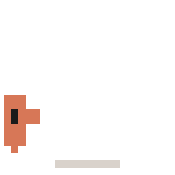</td><td align="center">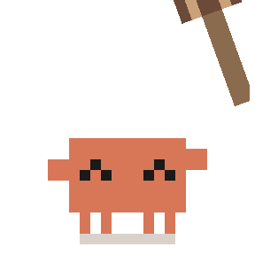</td></tr>
  <tr><td align="center" width="20%"><b>git clone</b></td><td align="center" width="20%"><b>git stash</b></td><td align="center" width="20%"><b>cherry-pick</b></td><td align="center" width="20%"><b>Merge Conflict</b></td><td align="center" width="20%"><b>Force Push</b></td></tr>
  <tr><td align="center">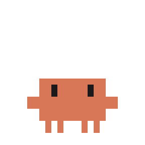</td><td align="center">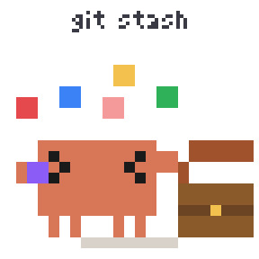</td><td align="center">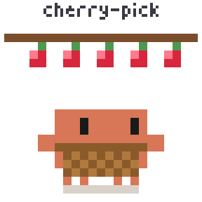</td><td align="center">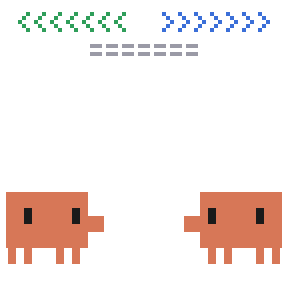</td><td align="center">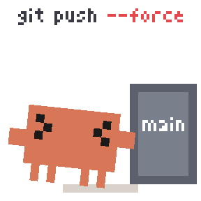</td></tr>
  <tr><td align="center" width="20%"><b>git blame</b></td><td align="center" width="20%"><b>rm -rf</b></td><td align="center" width="20%"><b>detached HEAD</b></td><td align="center" width="20%"><b>404 Not Found</b></td><td align="center" width="20%"><b>Error</b></td></tr>
  <tr><td align="center">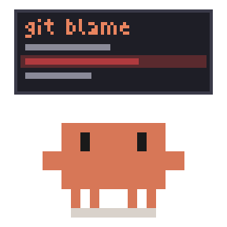</td><td align="center">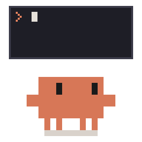</td><td align="center">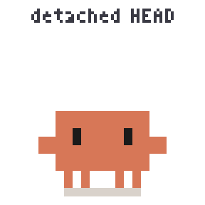</td><td align="center">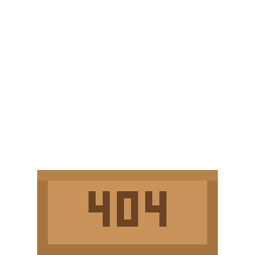</td><td align="center"></td></tr>
  <tr><td align="center" width="20%"><b>Bug Hunt</b></td><td align="center" width="20%"><b>Rubber Duck</b></td><td align="center" width="20%"><b>while(true)</b></td><td align="center" width="20%"><b>Stack Overflow</b></td><td align="center" width="20%"><b>Memory Leak</b></td></tr>
  <tr><td align="center">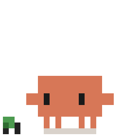</td><td align="center">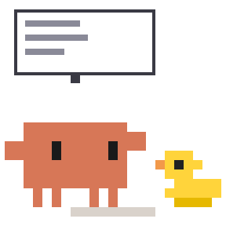</td><td align="center">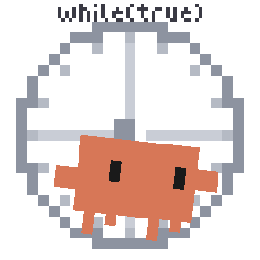</td><td align="center">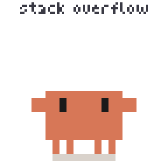</td><td align="center">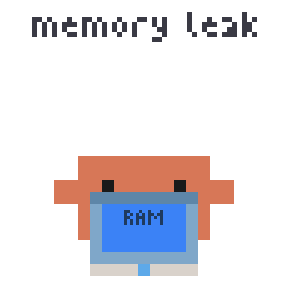</td></tr>
  <tr><td align="center" width="20%"><b>Works on My Machine</b></td><td align="center" width="20%"><b>Tests Passed</b></td><td align="center" width="20%"><b>Friday Deploy</b></td><td align="center" width="20%"><b>Deadline</b></td><td align="center" width="20%"><b>Overtime</b></td></tr>
  <tr><td align="center">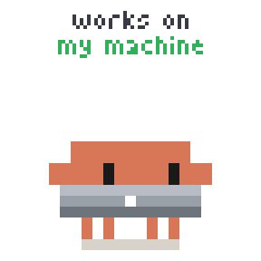</td><td align="center">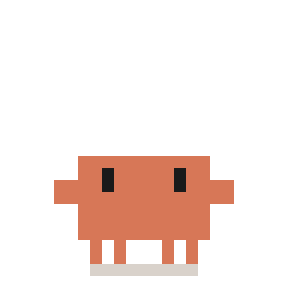</td><td align="center">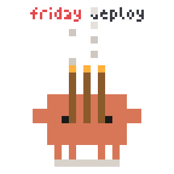</td><td align="center">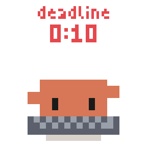</td><td align="center">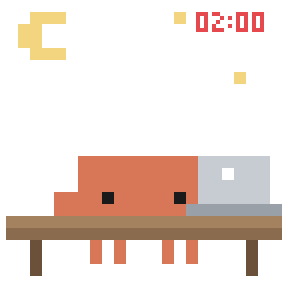</td></tr>
  <tr><td align="center" width="20%"><b>Coffee Break</b></td><td align="center" width="20%"><b>Slacking Off</b></td><td align="center" width="20%"><b>Clock Out</b></td><td align="center" width="20%"><b>Good Night</b></td><td align="center" width="20%"><b>/exit</b></td></tr>
  <tr><td align="center">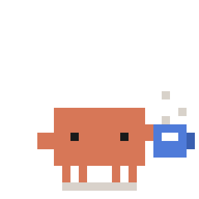</td><td align="center">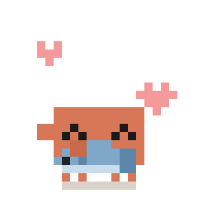</td><td align="center">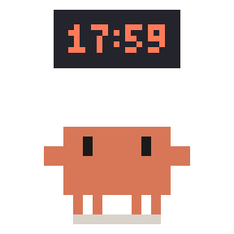</td><td align="center">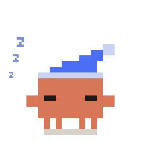</td><td align="center">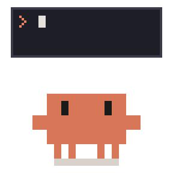</td></tr>
</table>

## Download and use

### Save a single sticker

1. Choose a sticker from the preview above or open the [set guide](dev-life/README.md).
2. Click its GIF to open the original, then right-click to save the `.gif` file.

### Download the whole set

Select **Code → Download ZIP** on the repository home page, extract the archive and open [`dev-life/gif/`](dev-life/gif/) to find the whole sticker collection for light backgrounds. The dark-background set is in [`dev-life/gif-dark/`](dev-life/gif-dark/). You can also clone the repository with the Git commands below.

### Add and use stickers in chat apps

Saved GIFs can be sent directly in chat apps such as WeChat, Xiaohongshu and WhatsApp. If the app supports custom stickers, you can also add them manually. All GIFs are 288×288 with a transparent background and loop continuously.

## Desktop pet theme

The set is also packaged as the **Clawd Dev Life** theme for [clawd-on-desk](https://github.com/rullerzhou-afk/clawd-on-desk). It retains most of the original sticker animations, playing them in sync with Claude Code's working state. It also adds theme-specific idle, walking and dragging animations, adapts some stickers for desktop use, and includes dedicated animations for two simultaneous sessions and for three or more sessions.

### Install the theme

Install clawd-on-desk first. Ready-to-install themes are included in this repository.

| Desktop background | Theme folder | Name shown in the app |
|---|---|---|
| Light | [`clawd-dev-life`](dev-life/theme/clawd-dev-life/) | Clawd Dev Life |
| Dark | [`clawd-dev-life-dark`](dev-life/theme/clawd-dev-life-dark/) | Clawd Dev Life (Dark) |

The themes directory depends on your operating system:

| System | Themes directory |
|---|---|
| Windows | `%APPDATA%/clawd-on-desk/themes/` |
| macOS | `~/Library/Application Support/clawd-on-desk/themes/` |
| Linux | `~/.config/clawd-on-desk/themes/` |

1. Download this repository and choose the folder in `dev-life/theme/` that suits your desktop background.
2. Copy the **entire folder** into the themes directory listed above, keeping its `theme.json` and `assets/` intact.
3. In clawd-on-desk, open **Settings... → Theme** and select the matching theme name. Restart clawd-on-desk if it doesn't appear.

### Animations and interactions

- **State-driven animations**: thinking, working, subagents, context compaction, permission requests, task completion, errors and other states each have matching animations.
- **Multiple sessions**: a single session uses the original stickers; two sessions or three or more sessions use new animations featuring multiple Clawds.
- **Desktop interactions**: Clawd breathes and blinks while idle, follows the mouse with its eyes and randomly plays everyday scenes. It supports walking, dragging, clicking, repeated clicks and a dizzy reaction when you circle the mouse around it. The dizzy reaction is a variation of Usage Limit rather than a conventional dizzy animation.
- **Sleep sequence**: Clawd struggles to keep its eyes open before putting on a nightcap and falling asleep. The wake-up animation leads into Coffee Break.

Mini mode and snapping to screen edges are currently unsupported. No custom sound effects are included.

You can view and adjust the animation configuration in clawd-on-desk settings. Any animations you don't like can be disabled or replaced manually.

## Generate locally

Run the included Python script to edit animations or regenerate GIFs.

### Requirements

- Python 3.10 or later and pip.
- The Pillow image library, at the version pinned in [`requirements.txt`](requirements.txt).
- Git if cloning the repository; downloading a ZIP is also supported.

### Get the repository and install dependencies

```bash
git clone https://github.com/alwinecor/clawd-stickers.git
cd clawd-stickers
python -m pip install -r requirements.txt
```

### Generate everything

This command generates all stickers and both themes, light and dark, in one go:

```bash
python dev-life/build_all.py
```

### Generate stickers

To generate only some stickers, run these commands from the repository root:

```bash
# Generate all 40 stickers
python dev-life/src/clawd_dev.py

# Generate only the context-compaction sticker
python dev-life/src/clawd_dev.py compact

# Generate several selected stickers
python dev-life/src/clawd_dev.py thinking compact clear

# Generate the dark-background set (combines with the arguments above)
python dev-life/src/clawd_dev.py --dark

```

Output is saved to [`dev-life/gif/`](dev-life/gif/), or [`dev-life/gif-dark/`](dev-life/gif-dark/) with `--dark`, replacing GIFs with the same names. The dark colour swaps are listed in the `DARK` table at the top of the script. The script prints each sticker's name, frame count and file size.

Arguments match GIF filenames without the `.gif` extension, such as `thinking`, `compact` and `clear`. Run the script with `--help` for the full list. The script's `ALL` list and `FILE` mapping define the generator entry points and output names; `clear` maps to the `clear_ctx()` function.

### Generate the clawd-on-desk theme

Rebuild only after changing animations or the theme configuration. The theme calls the sticker generators directly, so it doesn't depend on the files in `gif/` or `gif-dark/`.

```bash
# Light theme
python dev-life/theme/build.py

# Dark theme
python dev-life/theme/build.py --dark
```

Output is written to `clawd-dev-life/` or `clawd-dev-life-dark/` under [`dev-life/theme/`](dev-life/theme/), replacing the corresponding configuration and animation assets with the same names. The `THEME` table in `build.py` maps states to animations, `animations.py` holds theme-specific frame animations that differ from the original stickers, and `svg.py` holds the idle, walking and dragging animations.

### Check generated files

This command rebuilds all stickers and themes in a temporary copy, then lists any committed files that no longer match their source. It changes nothing in the repository and also runs automatically on GitHub for pushes to `main` and for pull requests.

```bash
python dev-life/check.py
```

## Repository structure

```text
clawd-stickers/
├── README.md                  # English project guide
├── README.zh-CN.md            # Chinese project guide
├── LICENSE                    # Standard MIT License
├── requirements.txt           # Pinned Python dependencies
├── .github/workflows/         # Automatic check of generated files
├── promo/                     # Share images (3:4, 20 stickers per page)
│   ├── covers/                # Animated pages and stills, dark and light
│   └── make_covers.py         # Share image generator
└── dev-life/                  # Dev Life sticker set
    ├── README.md              # English sticker content guide
    ├── README.zh-CN.md        # Chinese sticker content guide
    ├── build_all.py           # Generate all stickers and themes
    ├── check.py               # Check that generated files match their source
    ├── gif/                   # 40 finished GIFs
    ├── gif-dark/              # 40 finished GIFs (dark background)
    ├── theme/                 # clawd-on-desk desktop pet themes
    │   ├── clawd-dev-life/       # Light theme package
    │   ├── clawd-dev-life-dark/  # Dark theme package
    │   ├── build.py           # Theme generator and state mapping
    │   ├── animations.py      # Theme-only frame animations
    │   └── svg.py             # Theme-only SVG animations
    └── src/
        └── clawd_dev.py       # Sticker drawing, animation and GIF export
```

## Contributing

Issues are welcome for sticker ideas and bug reports, as are PRs improving animations, desktop pet themes, documentation and translations. See [Generate locally](#generate-locally) for setup and generation commands.

- **Report a problem**: describe the affected sticker or theme and the steps to reproduce it. Include a screenshot or animation where possible. For desktop pet issues, also include your operating system and clawd-on-desk version. Please report issues with the clawd-on-desk application itself, rather than this theme, to the upstream project.
- **Change stickers**: drawing and animation code lives in [`dev-life/src/clawd_dev.py`](dev-life/src/clawd_dev.py). Keep the existing pixel style and run `python dev-life/build_all.py` to update the GIFs and themes. When adding a sticker, update `ALL`, the `FILE` mapping if needed, and the set guides and home page previews in both languages.
- **Change desktop pet themes**: state mappings, theme-specific frame animations and SVG animations live in `build.py`, `animations.py` and `svg.py` under `dev-life/theme/`, respectively. Edit the source files and rebuild both light and dark themes.
- **Submit a PR**: describe the changes, include previews where applicable, and submit the source files together with updated assets and relevant documentation. Run `python dev-life/check.py` before submitting. Check transparency, text readability and loop transitions on both light and dark backgrounds. For desktop pet changes, also check the affected states or interactions. Update both English and Chinese documentation when usage or the collection changes.

## License and usage

Except for third-party material and rights otherwise noted, this project's code, documentation and original artistic contributions are licensed under the [MIT License](LICENSE), to the extent that contributors hold the relevant copyright. This includes original contributions to the sticker artwork.

- **Content covered by MIT**: use, modification, distribution and commercial use are permitted. Retain applicable copyright and license notices when distributing copies or substantial portions, including attribution for adapted upstream code.
- **Third-party material and rights**: The Claude Code mascot belongs to Anthropic.

## Credits

- Thanks to [@Qisi3344](https://github.com/Qisi3344) and [clawd-moji](https://github.com/Qisi3344/clawd-moji) for the drawing tools and creative inspiration used in this project!
- Drawing helpers in this repository's [`clawd_dev.py`](dev-life/src/clawd_dev.py), including `base`, `xform`, `squash`, `kf`, `face` and `render`, are adapted from that project's `clawd_movies.py` and `clawd_movies_more.py`.
- Thanks to [clawd-on-desk](https://github.com/rullerzhou-afk/clawd-on-desk) for the desktop pet app and custom theme support, bringing these stickers to the desktop as a companion for everyday development.
- [Anthropic](https://www.anthropic.com) owns the Clawd character.
