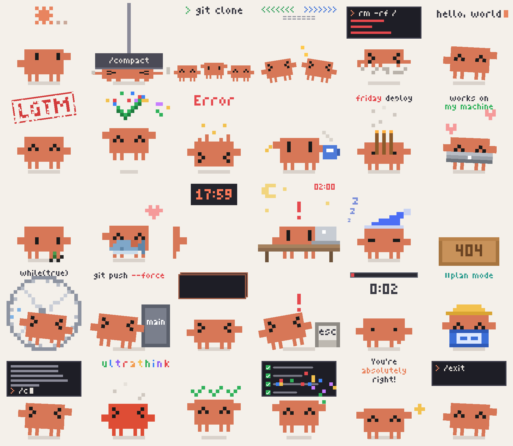

# clawd-stickers

[English](README.md) | 简体中文

Claude Code 吉祥物 Clawd 的像素表情包合集。一套一个主题，全部用代码生成。

> [!NOTE]
> Clawd 角色属于 Anthropic。本仓库是粉丝创作，非官方、非商用，详见 [LICENSE](LICENSE)。

## 怎么用

挑一套点开，选一个喜欢的，右键或长按保存 GIF 就能用。在微信里用的话，拿各套 `wechat/` 文件夹里的小尺寸版，发到「文件传输助手」，点开长按 →「添加到表情」。

## 套装

| 编号 | 主题 | 内容 | 状态 |
|---|---|---|---|
| 01 | [克码人生 · Dev Life](01-dev-life/README.zh-CN.md) | 程序员日常 · 30 个 | 完成 |

## 结构

每套一个文件夹：

- `gif/`：成品动图（原尺寸 276×288）
- `wechat/`：微信尺寸版（240×240，≤100KB）
- `preview.png`：这套的总览图
- `src/`：这套的生成代码
- `README.md` / `README.zh-CN.md`：这套的清单和小剧情

## 致谢

- 项目思路、Clawd 的像素画法和套装结构都来自 [@Qisi3344](https://github.com/Qisi3344) 的 [clawd-moji](https://github.com/Qisi3344/clawd-moji)：15×16 的身体网格、黑方块眼睛不画嘴、一套一个主题，以及 `gif/` + `wechat/` + `src/` 的目录结构。
- `01-dev-life/src/clawd_dev.py` 里的绘图工具函数（`base`、`xform`、`squash`、`kf`、`face`、`render`、`save` 等）改编自原作的 `clawd_movies.py` 和 `clawd_movies_more.py`。
- Clawd 角色属于 [Anthropic](https://www.anthropic.com)。
