# Clawd Stickers

[English](README.md) | 简体中文

以 Claude Code 吉祥物 **Clawd** 为主角的像素风动态表情包合集。通过 Python 代码绘制角色、道具与逐帧动画，并提供可直接保存使用的 GIF。

当前收录 **40 个动态表情**，主题为「克码人生 · Dev Life」。

> [!NOTE]
> 本项目为非官方粉丝创作，与 Anthropic 无关联，亦未获得其背书。本项目贡献者拥有版权的内容默认采用 [MIT 许可](LICENSE)；Claude Code 吉祥物等第三方权利除外。

## 目录

- [项目特点](#项目特点)
- [表情预览](#表情预览)
- [下载与使用](#下载与使用)
- [本地生成](#本地生成)
- [目录结构](#目录结构)
- [许可与使用范围](#许可与使用范围)
- [致谢](#致谢)

## 项目特点

- **围绕开发者日常，融入程序员梗**：包含 hello world、git clone、Rubber Duck 等程序员梗，以及摸鱼、下班、捉虫之类日常剧场。还有许多 Claude Code 个性化内容，比如 thinking、上下文压缩、额度上限等，以及一个封号梗。
- **统一的像素风格**：沿用 Clawd 的像素形象进行二创。
- **成品直接可用**：全部 GIF 均为 288×288 像素、透明背景、循环播放，可以直接下载使用，无需安装开发环境。
- **浅色、深色背景各一套**：深色版调亮了文字与描边、压暗了地面阴影，适合深色模式聊天界面。
- **可用代码重新生成**：生成脚本依赖 Pillow，无需额外下载字体文件，支持本地生成全部或指定表情。

## 表情预览

目前包含「克码人生 · Dev Life」主题共 40 个表情包。具体内容见[套装说明](dev-life/README.zh-CN.md)。

<table>
  <tr><td align="center" width="20%"><b>你好，世界</b><br>hello, world</td><td align="center" width="20%"><b>思考中</b><br>Thinking</td><td align="center" width="20%"><b>深度思考</b><br>ultrathink</td><td align="center" width="20%"><b>计划模式</b><br>Plan Mode</td><td align="center" width="20%"><b>待办清单</b><br>Todo List</td></tr>
  <tr><td align="center">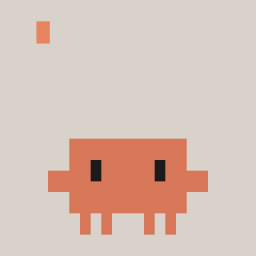</td><td align="center">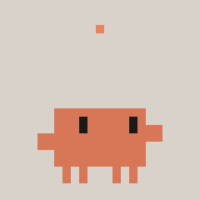</td><td align="center"></td><td align="center"></td><td align="center"></td></tr>
  <tr><td align="center" width="20%"><b>很简单</b><br>It's Simple</td><td align="center" width="20%"><b>子代理</b><br>Subagents</td><td align="center" width="20%"><b>疯狂同意</b><br>Yes, Proceed</td><td align="center" width="20%"><b>批准</b><br>LGTM</td><td align="center" width="20%"><b>您说得对</b><br>You're Absolutely Right!</td></tr>
  <tr><td align="center">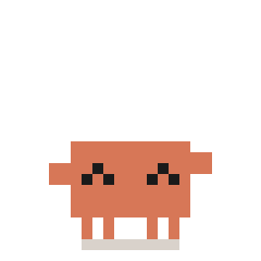</td><td align="center">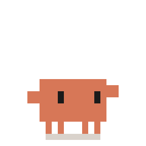</td><td align="center"></td><td align="center"></td><td align="center"></td></tr>
  <tr><td align="center" width="20%"><b>上下文压缩</b><br>/compact</td><td align="center" width="20%"><b>清空上下文</b><br>/clear</td><td align="center" width="20%"><b>额度用完</b><br>Usage Limit</td><td align="center" width="20%"><b>急停</b><br>Esc</td><td align="center" width="20%"><b>封号</b><br>Banned</td></tr>
  <tr><td align="center"></td><td align="center"></td><td align="center">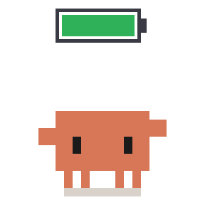</td><td align="center">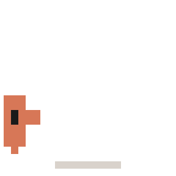</td><td align="center">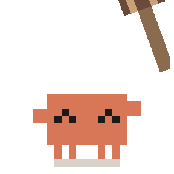</td></tr>
  <tr><td align="center" width="20%"><b>克隆</b><br>git clone</td><td align="center" width="20%"><b>藏起来</b><br>git stash</td><td align="center" width="20%"><b>摘樱桃</b><br>cherry-pick</td><td align="center" width="20%"><b>合并冲突</b><br>Merge Conflict</td><td align="center" width="20%"><b>强推</b><br>Force Push</td></tr>
  <tr><td align="center">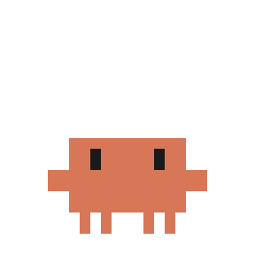</td><td align="center">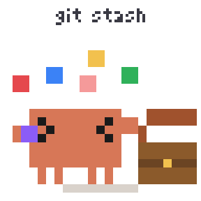</td><td align="center">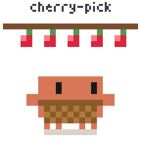</td><td align="center">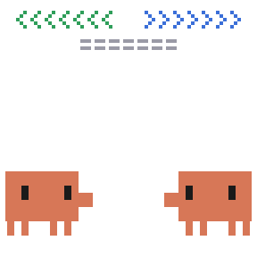</td><td align="center"></td></tr>
  <tr><td align="center" width="20%"><b>甩锅</b><br>git blame</td><td align="center" width="20%"><b>删库</b><br>rm -rf</td><td align="center" width="20%"><b>头掉了</b><br>detached HEAD</td><td align="center" width="20%"><b>找不到</b><br>404 Not Found</td><td align="center" width="20%"><b>报错</b><br>Error</td></tr>
  <tr><td align="center"></td><td align="center"></td><td align="center"></td><td align="center">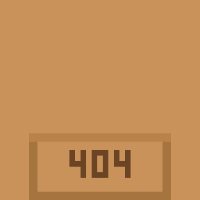</td><td align="center"></td></tr>
  <tr><td align="center" width="20%"><b>抓虫</b><br>Bug Hunt</td><td align="center" width="20%"><b>小黄鸭调试</b><br>Rubber Duck</td><td align="center" width="20%"><b>死循环</b><br>while(true)</td><td align="center" width="20%"><b>栈溢出</b><br>Stack Overflow</td><td align="center" width="20%"><b>内存泄漏</b><br>Memory Leak</td></tr>
  <tr><td align="center">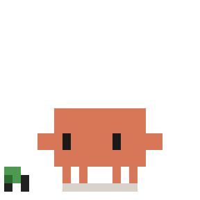</td><td align="center">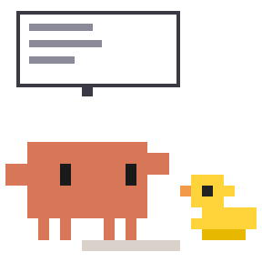</td><td align="center"></td><td align="center">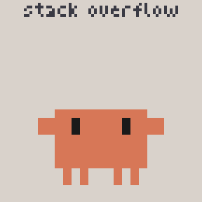</td><td align="center"></td></tr>
  <tr><td align="center" width="20%"><b>在我电脑上能跑</b><br>Works on My Machine</td><td align="center" width="20%"><b>测试通过</b><br>Tests Passed</td><td align="center" width="20%"><b>周五上线</b><br>Friday Deploy</td><td align="center" width="20%"><b>赶工</b><br>Deadline</td><td align="center" width="20%"><b>加班</b><br>Overtime</td></tr>
  <tr><td align="center">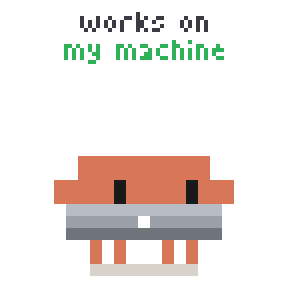</td><td align="center"></td><td align="center"></td><td align="center"></td><td align="center">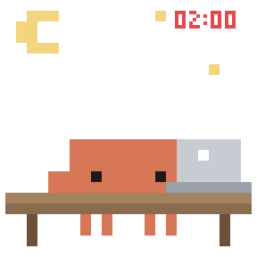</td></tr>
  <tr><td align="center" width="20%"><b>咖啡续命</b><br>Coffee Break</td><td align="center" width="20%"><b>摸鱼</b><br>Slacking Off</td><td align="center" width="20%"><b>下班</b><br>Clock Out</td><td align="center" width="20%"><b>晚安</b><br>Good Night</td><td align="center" width="20%"><b>拜拜</b><br>/exit</td></tr>
  <tr><td align="center">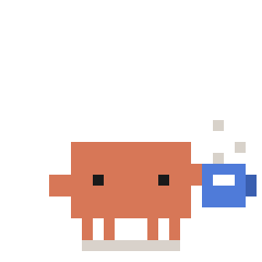</td><td align="center">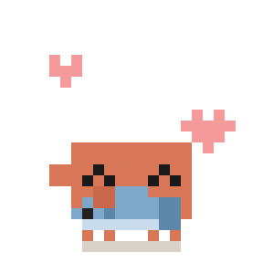</td><td align="center">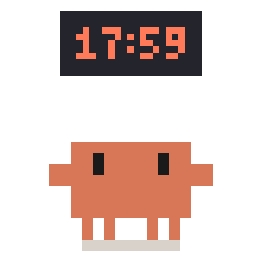</td><td align="center">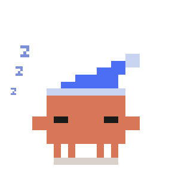</td><td align="center">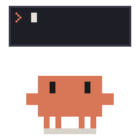</td></tr>
</table>

## 下载与使用

### 保存单个表情

1. 通过上方的预览图，或打开[套装说明](dev-life/README.zh-CN.md)，挑选喜欢的表情包。
2. 点击对应 GIF，打开原图后右键保存为 `.gif` 文件。

### 下载全套

在仓库首页选择 **Code → Download ZIP**，解压后打开 [`dev-life/gif/`](dev-life/gif/) 即可获取全套表情包，适用于浅色背景。适用深色背景的版本见 [`dev-life/gif-dark/`](dev-life/gif-dark/)。也可以通过下方的 Git 命令克隆仓库。

### 在聊天应用中添加和使用

保存好的 GIF 文件都可以在聊天应用中直接发送，如：微信，小红书，Whatsapp 等。如果应用支持，也可以手动添加为自定义表情。全部 GIF 均为 288×288 像素、透明背景、循环播放。

## 本地生成

如需调整动画或重新生成 GIF，可运行仓库内的 Python 脚本。

### 环境要求

- Python 3 与 pip。
- Pillow 图像处理库。
- Git（使用克隆方式下载时需要；也可下载 ZIP）。

### 获取仓库并安装依赖

```bash
git clone https://github.com/alwinecor/clawd-stickers.git
cd clawd-stickers
python -m pip install Pillow
```

### 生成表情

在仓库根目录执行以下命令：

```bash
# 生成整套 40 个表情
python dev-life/src/clawd_dev.py

# 只生成「上下文压缩」
python dev-life/src/clawd_dev.py compact

# 一次生成多个指定表情
python dev-life/src/clawd_dev.py thinking compact clear

# 生成深色背景版（可与上面的参数组合）
python dev-life/src/clawd_dev.py --dark
```

生成结果写入 [`dev-life/gif/`](dev-life/gif/)，加 `--dark` 时写入 [`dev-life/gif-dark/`](dev-life/gif-dark/)，会覆盖同名 GIF。深色版的换色规则见脚本开头的 `DARK` 表。脚本会输出每个表情的名称、帧数与文件大小。

参数通常与 GIF 文件名一致，不含 `.gif` 后缀，例如 `thinking`、`compact`、`clear`。完整名称可查看成品目录；脚本中的 `ALL` 列表及 `FILE` 映射定义了生成入口与输出名称，其中 `clear` 对应函数 `clear_ctx()`。

## 目录结构

```text
clawd-stickers/
├── README.md                  # 英文项目说明
├── README.zh-CN.md            # 中文项目说明
├── LICENSE                    # 标准 MIT 许可
├── promo/                     # 分享图（3:4，每张 20 个表情）
│   ├── covers/                # 深浅两版动图与静态图
│   └── make_covers.py         # 分享图生成脚本
└── dev-life/                  # 克码人生主题套装
    ├── README.md              # 英文表情包内容说明
    ├── README.zh-CN.md        # 中文表情包内容说明
    ├── gif/                   # 40 个成品 GIF
    ├── gif-dark/              # 40 个成品 GIF（深色背景）
    └── src/
        └── clawd_dev.py       # 绘图、动画与 GIF 导出脚本
```

## 许可与使用范围

除另有注明的第三方内容及权利外，本项目贡献者拥有版权的代码、文档与原创美术贡献默认采用 [MIT 许可](LICENSE)，包括表情素材中的原创部分。

- **MIT 覆盖的内容**：允许使用、修改、分发和商用；分发副本或实质性部分时须保留适用的版权及许可声明，包括上游改编代码的署名。
- **第三方内容与权利**：Claude Code 吉祥物角色归 Anthropic 所有。

## 致谢

- 感谢 [@Qisi3344](https://github.com/Qisi3344) 的 [clawd-moji](https://github.com/Qisi3344/clawd-moji) 提供了本项目使用的绘图工具和创作思路！
- 本仓库 [`clawd_dev.py`](dev-life/src/clawd_dev.py) 中的绘图工具函数（如 `base`、`xform`、`squash`、`kf`、`face`、`render` 等）改编自该项目的 `clawd_movies.py` 与 `clawd_movies_more.py`。
- [Anthropic](https://www.anthropic.com)：Clawd 角色的权利方。
