# Clawd Stickers

[English](README.md) | 简体中文

以 Claude Code 吉祥物 **Clawd** 为主角的像素风动态表情包合集。通过 Python 代码绘制角色、道具与逐帧动画，并提供可直接保存使用的 GIF。

当前收录 **40 个动态表情**，主题为「克码人生 · Dev Life」。

另附浅色、深色两版 [clawd-on-desk 桌宠主题](#桌宠主题)，让 Clawd 成为桌宠，随 Claude Code 的工作状态切换动画。

> [!NOTE]
> 本项目为非官方粉丝创作，与 Anthropic 无关联，亦未获得其背书。代码和文档采用 [MIT 许可](LICENSE)，美术素材采用 [CC BY-NC-SA 4.0](LICENSE-ART)，不允许商用；Claude Code 吉祥物等第三方权利除外。详见[许可与使用范围](#许可与使用范围)。

## 目录

- [项目特点](#项目特点)
- [表情预览](#表情预览)
- [下载与使用](#下载与使用)
- [桌宠主题](#桌宠主题)
- [本地生成](#本地生成)
- [目录结构](#目录结构)
- [贡献指引](#贡献指引)
- [许可与使用范围](#许可与使用范围)
- [致谢](#致谢)

## 项目特点

- **围绕开发者日常，融入程序员梗**：包含 hello world、git clone、Rubber Duck 等程序员梗，以及摸鱼、下班、捉虫之类日常剧场。还有许多 Claude Code 个性化内容，比如 thinking、上下文压缩、额度上限等，以及一个封号梗。
- **统一的像素风格**：沿用 Clawd 的像素形象进行二创。
- **成品直接可用**：全部 GIF 均为 288×288 像素、透明背景、循环播放，可以直接下载使用，无需安装开发环境。
- **浅色、深色背景各一套**：深色版调亮了文字与描边、压暗了地面阴影，适合深色模式聊天界面。
- **可用代码重新生成**：生成脚本依赖 Pillow，无需额外下载字体文件，支持本地生成全部或指定表情。
- **支持导入 clawd-on-desk 桌宠应用**：将原版表情包做成了适配 clawd-on-desk 的专门主题，可以手动导入自定义主题，替换官方原版。

## 表情预览

目前包含「克码人生 · Dev Life」主题共 40 个表情包。具体内容见[套装说明](dev-life/README.zh-CN.md)。

<table>
  <tr><td align="center" width="20%"><b>你好，世界</b><br>hello, world</td><td align="center" width="20%"><b>思考中</b><br>Thinking</td><td align="center" width="20%"><b>深度思考</b><br>ultrathink</td><td align="center" width="20%"><b>计划模式</b><br>Plan Mode</td><td align="center" width="20%"><b>待办清单</b><br>Todo List</td></tr>
  <tr><td align="center">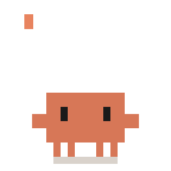</td><td align="center">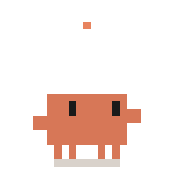</td><td align="center"></td><td align="center">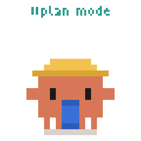</td><td align="center">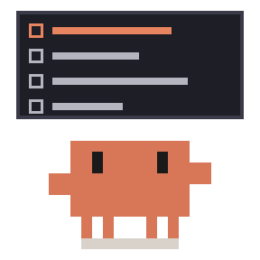</td></tr>
  <tr><td align="center" width="20%"><b>很简单</b><br>It's Simple</td><td align="center" width="20%"><b>子代理</b><br>Subagents</td><td align="center" width="20%"><b>疯狂同意</b><br>Yes, Proceed</td><td align="center" width="20%"><b>批准</b><br>LGTM</td><td align="center" width="20%"><b>您说得对</b><br>You're Absolutely Right!</td></tr>
  <tr><td align="center">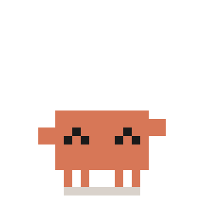</td><td align="center">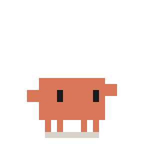</td><td align="center">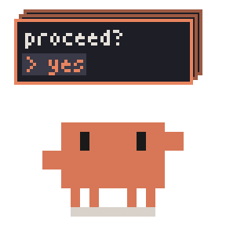</td><td align="center">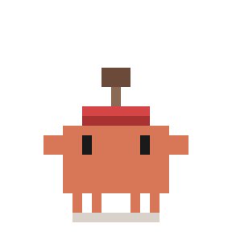</td><td align="center"></td></tr>
  <tr><td align="center" width="20%"><b>上下文压缩</b><br>/compact</td><td align="center" width="20%"><b>清空上下文</b><br>/clear</td><td align="center" width="20%"><b>额度用完</b><br>Usage Limit</td><td align="center" width="20%"><b>急停</b><br>Esc</td><td align="center" width="20%"><b>封号</b><br>Banned</td></tr>
  <tr><td align="center"></td><td align="center">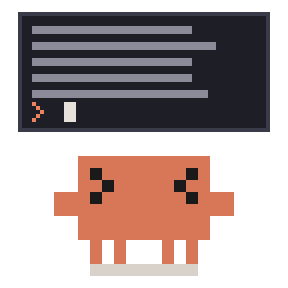</td><td align="center">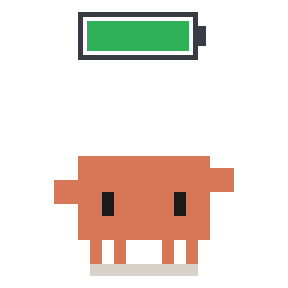</td><td align="center">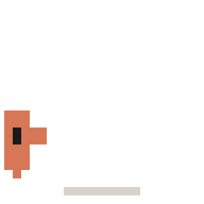</td><td align="center">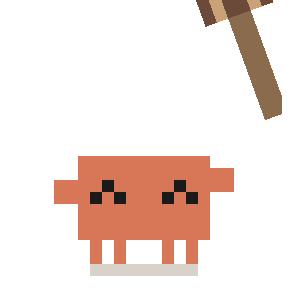</td></tr>
  <tr><td align="center" width="20%"><b>克隆</b><br>git clone</td><td align="center" width="20%"><b>藏起来</b><br>git stash</td><td align="center" width="20%"><b>摘樱桃</b><br>cherry-pick</td><td align="center" width="20%"><b>合并冲突</b><br>Merge Conflict</td><td align="center" width="20%"><b>强推</b><br>Force Push</td></tr>
  <tr><td align="center">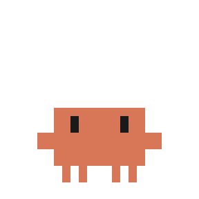</td><td align="center">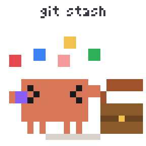</td><td align="center">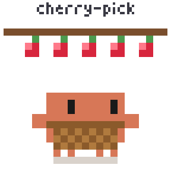</td><td align="center">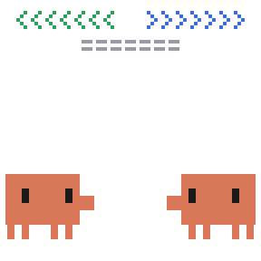</td><td align="center">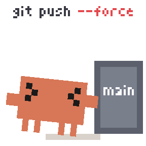</td></tr>
  <tr><td align="center" width="20%"><b>甩锅</b><br>git blame</td><td align="center" width="20%"><b>删库</b><br>rm -rf</td><td align="center" width="20%"><b>头掉了</b><br>detached HEAD</td><td align="center" width="20%"><b>找不到</b><br>404 Not Found</td><td align="center" width="20%"><b>报错</b><br>Error</td></tr>
  <tr><td align="center">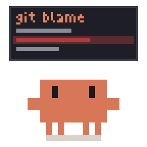</td><td align="center">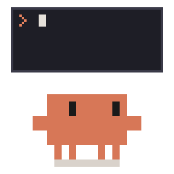</td><td align="center">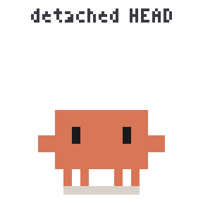</td><td align="center">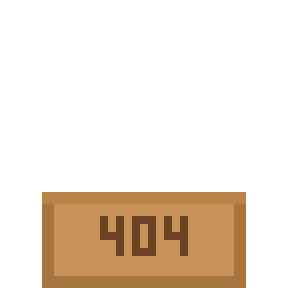</td><td align="center"></td></tr>
  <tr><td align="center" width="20%"><b>抓虫</b><br>Bug Hunt</td><td align="center" width="20%"><b>小黄鸭调试</b><br>Rubber Duck</td><td align="center" width="20%"><b>死循环</b><br>while(true)</td><td align="center" width="20%"><b>栈溢出</b><br>Stack Overflow</td><td align="center" width="20%"><b>内存泄漏</b><br>Memory Leak</td></tr>
  <tr><td align="center">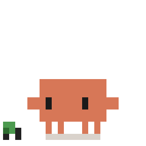</td><td align="center">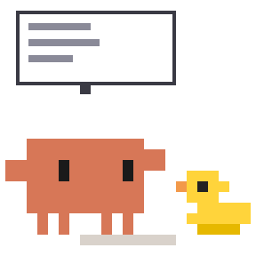</td><td align="center">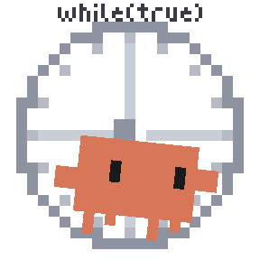</td><td align="center">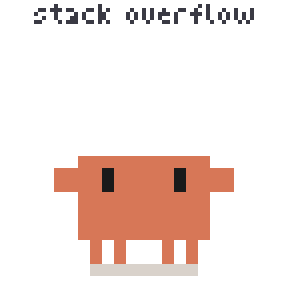</td><td align="center">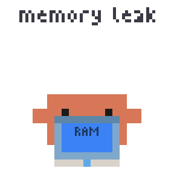</td></tr>
  <tr><td align="center" width="20%"><b>在我电脑上能跑</b><br>Works on My Machine</td><td align="center" width="20%"><b>测试通过</b><br>Tests Passed</td><td align="center" width="20%"><b>周五上线</b><br>Friday Deploy</td><td align="center" width="20%"><b>赶工</b><br>Deadline</td><td align="center" width="20%"><b>加班</b><br>Overtime</td></tr>
  <tr><td align="center">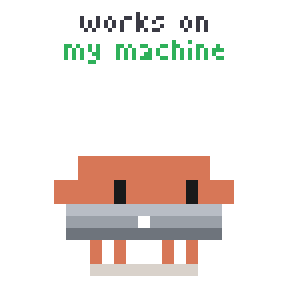</td><td align="center">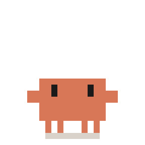</td><td align="center">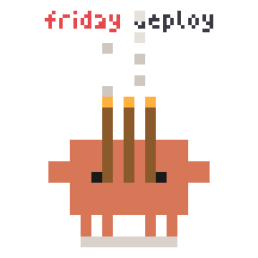</td><td align="center">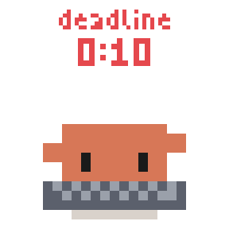</td><td align="center">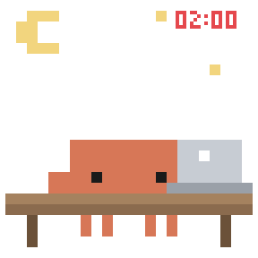</td></tr>
  <tr><td align="center" width="20%"><b>咖啡续命</b><br>Coffee Break</td><td align="center" width="20%"><b>摸鱼</b><br>Slacking Off</td><td align="center" width="20%"><b>下班</b><br>Clock Out</td><td align="center" width="20%"><b>晚安</b><br>Good Night</td><td align="center" width="20%"><b>拜拜</b><br>/exit</td></tr>
  <tr><td align="center">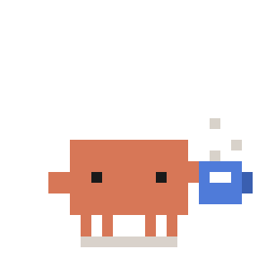</td><td align="center">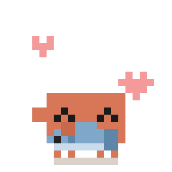</td><td align="center">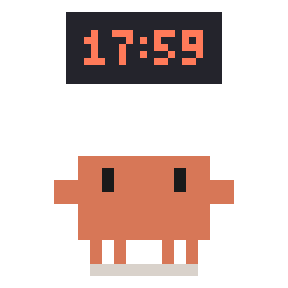</td><td align="center">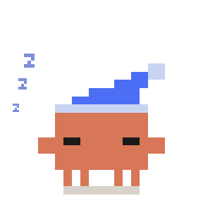</td><td align="center">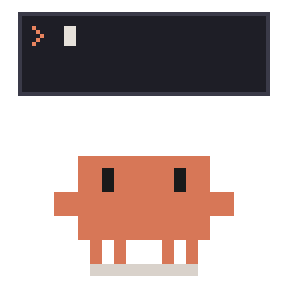</td></tr>
</table>

## 下载与使用

### 保存单个表情

1. 通过上方的预览图，或打开[套装说明](dev-life/README.zh-CN.md)，挑选喜欢的表情包。
2. 点击对应 GIF，打开原图后右键保存为 `.gif` 文件。

### 下载全套

在仓库首页选择 **Code → Download ZIP**，解压后打开 [`dev-life/gif/`](dev-life/gif/) 即可获取全套表情包，适用于浅色背景。适用深色背景的版本见 [`dev-life/gif-dark/`](dev-life/gif-dark/)。也可以通过下方的 Git 命令克隆仓库。

### 在聊天应用中添加和使用

保存好的 GIF 文件都可以在聊天应用中直接发送，如：微信，小红书，Whatsapp 等。如果应用支持，也可以手动添加为自定义表情。全部 GIF 均为 288×288 像素、透明背景、循环播放。

## 桌宠主题

这套表情也打包成了 [clawd-on-desk](https://github.com/rullerzhou-afk/clawd-on-desk) 的 **Clawd Dev Life** 桌宠主题。保留了原版表情包的全部动画，跟随 Claude Code 的工作状态同步播放。此外还补充了待机、走动、拖拽等主题专用动画，对部分表情做了适配调整，并加入了用于 2 个会话同时进行 / 3个及以上会话同时进行的专用动画。

### 安装主题

使用前需先安装 clawd-on-desk。仓库中已包含构建好的主题，下载后即可安装。

| 适用桌面 | 主题文件夹 | 在应用中显示的名称 |
|---|---|---|
| 浅色 | [`clawd-dev-life`](dev-life/theme/clawd-dev-life/) | Clawd Dev Life |
| 深色 | [`clawd-dev-life-dark`](dev-life/theme/clawd-dev-life-dark/) | Clawd Dev Life (Dark) |

各系统的主题目录如下：

| 系统 | 主题目录 |
|---|---|
| Windows | `%APPDATA%/clawd-on-desk/themes/` |
| macOS | `~/Library/Application Support/clawd-on-desk/themes/` |
| Linux | `~/.config/clawd-on-desk/themes/` |

1. 下载本仓库，在 `dev-life/theme/` 中选择适合桌面背景的主题文件夹。
2. 将该文件夹**整体复制**到上表对应的主题目录，保留其中的 `theme.json` 和 `assets/`。
3. 打开 clawd-on-desk 的 **Settings... → Theme**，选择对应的主题名称。如果没出现，重启一下 clawd-on-desk。

### 动画与交互

<table>
  <tr><td align="center" width="16%"><b>Team of Two</b></td><td align="center" width="16%"><b>Team of Three</b></td><td align="center" width="16%"><b>Dizzy</b></td><td align="center" width="16%"><b>Yawn</b></td><td align="center" width="16%"><b>Wake</b></td><td align="center" width="16%"><b>/exit (extended)</b></td></tr>
  <tr><td align="center"></td><td align="center"></td><td align="center"></td><td align="center"></td><td align="center"></td><td align="center"></td></tr>
</table>

各动画的触发时机和全部主题专属动画预览见[主题说明](dev-life/README.zh-CN.md#桌宠主题--clawd-dev-life)。

- **状态联动**：思考、工作、子代理、上下文压缩、等待授权、任务完成和报错等都有对应动画。
- **多会话动画**：单会话使用原版表情包，双会话或三个及以上会话使用全新动画，包含多个 Clawd。
- **桌面互动**：待机时呼吸眨眼、眼睛跟随鼠标，随机播放日常小剧场；支持走动、拖拽、点击、多次点击和绕圈晕眩反应。本主题未采用常见的晕眩动画，而是做了 Usage Limit 动画的改版。
- **睡眠流程**：从强撑着睁眼到戴睡帽入睡，唤醒动画接上咖啡续命。

目前不支持迷你模式或靠近屏幕边缘吸附。没有设计专用音效。

具体动画配置可以在 clawd-on-desk 设置中查看和调整。有不喜欢的动画，都可以手动关闭或替换。

## 本地生成

如需调整动画或重新生成 GIF，可运行仓库内的 Python 脚本。

### 环境要求

- Python 3.10 或更高版本与 pip。
- Pillow 图像处理库，版本以 [`requirements.txt`](requirements.txt) 为准。
- Git（使用克隆方式下载时需要；也可下载 ZIP）。

### 获取仓库并安装依赖

```bash
git clone https://github.com/alwinecor/clawd-stickers.git
cd clawd-stickers
python -m pip install -r requirements.txt
```

### 一键生成全部内容

以下命令会一次生成全部表情和浅色、深色两套主题：

```bash
python dev-life/build_all.py
```

### 生成表情

如只需生成部分表情，在仓库根目录执行以下命令：

```bash
# 生成整套 40 个表情
python dev-life/src/clawd_dev.py

# 只生成「上下文压缩」
python dev-life/src/clawd_dev.py compact

# 一次生成多个指定表情
python dev-life/src/clawd_dev.py thinking compact clear

# 生成深色背景版（可与上面的参数组合）
python dev-life/src/clawd_dev.py --dark

```

生成结果写入 [`dev-life/gif/`](dev-life/gif/)，加 `--dark` 时写入 [`dev-life/gif-dark/`](dev-life/gif-dark/)，会覆盖同名 GIF。深色版的换色规则见脚本开头的 `DARK` 表。脚本会输出每个表情的名称、帧数与文件大小。

参数与 GIF 文件名一致，不含 `.gif` 后缀，例如 `thinking`、`compact`、`clear`。完整名称可通过 `--help` 查看；脚本中的 `ALL` 列表及 `FILE` 映射定义了生成入口与输出名称，其中 `clear` 对应函数 `clear_ctx()`。

### 生成 clawd-on-desk 主题

仅在修改动画或主题配置后需要重新构建。主题会直接调用表情的生成函数，不依赖 `gif/` 或 `gif-dark/` 中的文件。

```bash
# 浅色主题
python dev-life/theme/build.py

# 深色主题
python dev-life/theme/build.py --dark
```

结果写入 [`dev-life/theme/`](dev-life/theme/) 下的 `clawd-dev-life/` 或 `clawd-dev-life-dark/`，会覆盖对应的配置和同名动画资源。`build.py` 里的 `THEME` 表是状态与动画的对应关系，`animations.py` 是与原版表情包不同、主题专用的逐帧动画，`svg.py` 是待机、走动和拖拽动画。

### 检查生成文件

以下命令会在临时副本中重建全部表情和主题，并列出与源码不一致的已提交文件。它不会改动仓库，推送到 `main` 和提交 PR 时也会在 GitHub 上自动运行。

```bash
python dev-life/check.py
```

## 目录结构

```text
clawd-stickers/
├── README.md                  # 英文项目说明
├── README.zh-CN.md            # 中文项目说明
├── LICENSE                    # 代码和文档的 MIT 许可
├── LICENSE-ART                # 美术素材的 CC BY-NC-SA 4.0 许可
├── NOTICE.md                  # 第三方内容与权利说明
├── requirements.txt           # 固定版本的 Python 依赖
├── .github/workflows/         # 生成文件的自动检查
└── dev-life/                  # 克码人生主题套装
    ├── README.md              # 英文表情包内容说明
    ├── README.zh-CN.md        # 中文表情包内容说明
    ├── build_all.py           # 一键生成全部表情和主题
    ├── check.py               # 检查生成文件是否与源码一致
    ├── gif/                   # 40 个成品 GIF
    ├── gif-dark/              # 40 个成品 GIF（深色背景）
    ├── theme/                 # clawd-on-desk 桌宠主题
    │   ├── clawd-dev-life/       # 浅色主题安装包
    │   ├── clawd-dev-life-dark/  # 深色主题安装包
    │   ├── package/           # 随主题分发的 LICENSE 和 README
    │   ├── build.py           # 主题生成脚本和状态对应表
    │   ├── animations.py      # 主题专用逐帧动画
    │   └── svg.py             # 主题专用 SVG 动画
    └── src/
        └── clawd_dev.py       # 表情绘图、动画与 GIF 导出脚本
```

## 贡献指引

欢迎通过 Issue 分享表情创意、反馈问题，也欢迎提交 PR 改进动画、桌宠主题、文档和翻译。开发环境与生成命令见[本地生成](#本地生成)。

- **反馈问题**：请说明涉及的表情或主题、复现步骤，尽量附上截图或动图。桌宠相关问题请补充操作系统与 clawd-on-desk 版本。涉及 clawd-on-desk 应用而不属于主题的问题，请向上游反馈。
- **修改表情**：绘图和动画位于 [`dev-life/src/clawd_dev.py`](dev-life/src/clawd_dev.py)。请保持现有像素风格，运行 `python dev-life/build_all.py` 更新 GIF 和主题；新增表情时同步更新 `ALL`、必要的 `FILE` 映射，以及中英文套装说明和首页预览。
- **修改桌宠主题**：状态映射、主题专用逐帧动画和 SVG 动画分别位于 `dev-life/theme/` 下的 `build.py`、`animations.py` 和 `svg.py`。请修改源文件后重新构建浅色、深色主题。
- **提交 PR**：请附上改动说明和适用的预览，将源文件、更新后的成品及相关文档一并提交。提交前请运行 `python dev-life/check.py`。在浅色、深色背景下检查透明区域、文字可读性和循环衔接；涉及桌宠时，再检查受影响的状态或交互。用法或收录内容有变化时，请同步更新中英文文档。

## 许可与使用范围

代码和美术分开授权，均以贡献者拥有相关版权的范围为限：

| 内容 | 许可 |
| --- | --- |
| 代码和文档 | [MIT](LICENSE) |
| 表情、主题图片，以及由代码重新生成的图片 | [CC BY-NC-SA 4.0](LICENSE-ART) |
| Clawd 角色及其他第三方内容 | 不在本项目授权范围内，见 [NOTICE.md](NOTICE.md) |

- **代码和文档**：允许使用、修改、分发和商用；分发副本或实质性部分时须保留适用的版权及许可声明，包括上游改编代码的署名。
- **美术素材**：可以在非商业用途下分享和改编；须署名本项目、注明修改，并以相同许可发布改编内容。商业使用须另行取得相关权利人的许可。
- **贡献**：提交 PR 即表示你同意代码和文档按 MIT 授权，美术素材按 CC BY-NC-SA 4.0 授权。
- **第三方内容与权利**：Claude Code 吉祥物角色归 Anthropic 所有。改编内容见 [NOTICE.md](NOTICE.md)。

## 致谢

- 感谢 [@Qisi3344](https://github.com/Qisi3344) 的 [clawd-moji](https://github.com/Qisi3344/clawd-moji) 提供了本项目使用的绘图工具和创作思路！
- 本仓库 [`clawd_dev.py`](dev-life/src/clawd_dev.py) 中的绘图工具函数（如 `base`、`xform`、`squash`、`kf`、`face`、`render` 等）改编自该项目的 `clawd_movies.py` 与 `clawd_movies_more.py`。
- 感谢 [clawd-on-desk](https://github.com/rullerzhou-afk/clawd-on-desk) 提供桌宠应用与自定义主题支持，让这套表情能以桌面伙伴的形式陪伴开发日常。
- [Anthropic](https://www.anthropic.com)：Clawd 角色的权利方。
