# clawd-stickers

[English](README.md) | 简体中文

以 Claude Code 吉祥物 **Clawd** 为主角的像素风动态表情包合集。每套围绕一个主题，用 Python 代码绘制角色、道具与逐帧动画，并提供可直接保存使用的 GIF。

当前收录 **1 套主题、40 个动态表情**，共同组成「克码人生 · Dev Life」。

> [!NOTE]
> 本项目为非官方粉丝创作，与 Anthropic 无关联，亦未获得其背书。Clawd 角色归 Anthropic 所有，仓库内容仅供个人非商业使用。详见 [LICENSE](LICENSE)。

## 目录

- [项目特点](#项目特点)
- [表情预览](#表情预览)
- [下载与使用](#下载与使用)
- [主题套装](#主题套装)
- [本地生成](#本地生成)
- [目录结构](#目录结构)
- [参与贡献](#参与贡献)
- [许可与使用范围](#许可与使用范围)
- [致谢](#致谢)

## 项目特点

- **围绕开发者日常创作**：把合并冲突、上下文压缩、摸鱼、下班等场景做成动态小剧场。
- **统一的像素风格**：沿用 Clawd 的 15×16 身体网格、黑色方块眼睛与无嘴造型，通过动作和道具表达情绪。
- **成品直接可用**：全部 GIF 均为 288×288 像素、透明背景、循环播放，使用表情包无需安装开发环境。
- **可用代码重新生成**：生成脚本依赖 Pillow，内置 3×5 像素字体，无需额外下载字体文件，支持生成全部或指定表情。
- **按主题组织**：每套包含独立的成品目录、生成代码及中英文说明，便于浏览和扩展。

## 表情预览

以下为「克码人生 · Dev Life」全套 40 个表情，按相近内容排列。每个表情的剧情见[套装说明](01-dev-life/README.zh-CN.md)。

<table>
  <tr><td align="center" width="20%"><b>你好，世界</b></td><td align="center" width="20%"><b>思考中</b></td><td align="center" width="20%"><b>深度思考</b></td><td align="center" width="20%"><b>计划模式</b></td><td align="center" width="20%"><b>待办清单</b></td></tr>
  <tr><td align="center">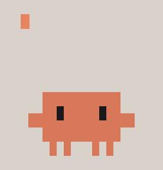</td><td align="center"></td><td align="center"></td><td align="center"></td><td align="center">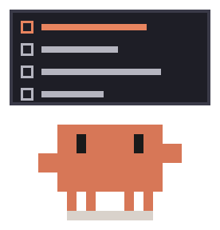</td></tr>
  <tr><td align="center" width="20%"><b>很简单</b></td><td align="center" width="20%"><b>子代理</b></td><td align="center" width="20%"><b>疯狂同意</b></td><td align="center" width="20%"><b>批准</b></td><td align="center" width="20%"><b>您说得对</b></td></tr>
  <tr><td align="center"></td><td align="center"></td><td align="center"></td><td align="center">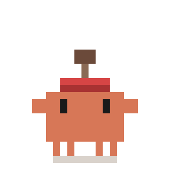</td><td align="center"></td></tr>
  <tr><td align="center" width="20%"><b>上下文压缩</b></td><td align="center" width="20%"><b>清空上下文</b></td><td align="center" width="20%"><b>额度用完</b></td><td align="center" width="20%"><b>急停</b></td><td align="center" width="20%"><b>封号</b></td></tr>
  <tr><td align="center">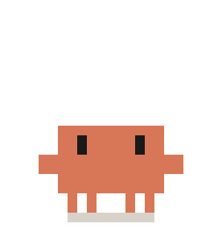</td><td align="center"></td><td align="center">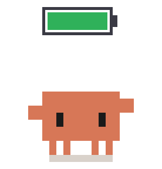</td><td align="center"></td><td align="center">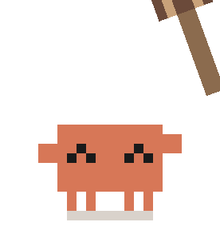</td></tr>
  <tr><td align="center" width="20%"><b>克隆</b></td><td align="center" width="20%"><b>藏起来</b></td><td align="center" width="20%"><b>摘樱桃</b></td><td align="center" width="20%"><b>合并冲突</b></td><td align="center" width="20%"><b>强推</b></td></tr>
  <tr><td align="center"></td><td align="center"></td><td align="center"></td><td align="center">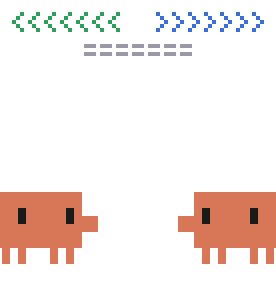</td><td align="center"></td></tr>
  <tr><td align="center" width="20%"><b>甩锅</b></td><td align="center" width="20%"><b>删库</b></td><td align="center" width="20%"><b>头掉了</b></td><td align="center" width="20%"><b>找不到</b></td><td align="center" width="20%"><b>报错</b></td></tr>
  <tr><td align="center">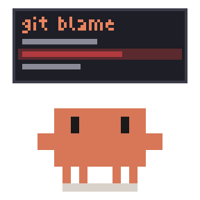</td><td align="center">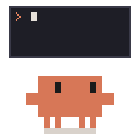</td><td align="center">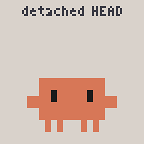</td><td align="center">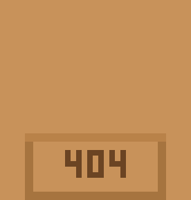</td><td align="center"></td></tr>
  <tr><td align="center" width="20%"><b>抓虫</b></td><td align="center" width="20%"><b>小黄鸭调试</b></td><td align="center" width="20%"><b>死循环</b></td><td align="center" width="20%"><b>栈溢出</b></td><td align="center" width="20%"><b>内存泄漏</b></td></tr>
  <tr><td align="center"></td><td align="center"></td><td align="center">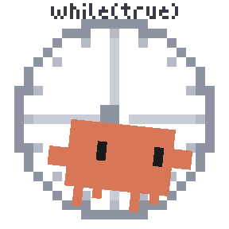</td><td align="center"></td><td align="center">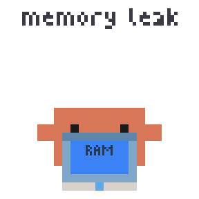</td></tr>
  <tr><td align="center" width="20%"><b>在我电脑上能跑</b></td><td align="center" width="20%"><b>测试通过</b></td><td align="center" width="20%"><b>周五上线</b></td><td align="center" width="20%"><b>赶工</b></td><td align="center" width="20%"><b>加班</b></td></tr>
  <tr><td align="center">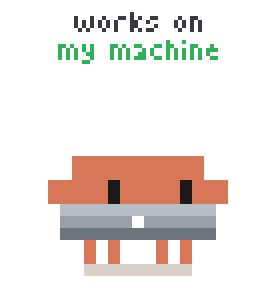</td><td align="center">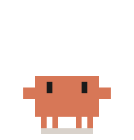</td><td align="center">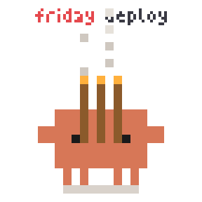</td><td align="center">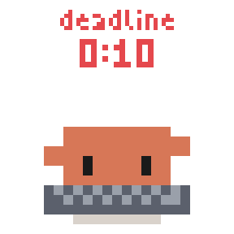</td><td align="center"></td></tr>
  <tr><td align="center" width="20%"><b>咖啡续命</b></td><td align="center" width="20%"><b>摸鱼</b></td><td align="center" width="20%"><b>下班</b></td><td align="center" width="20%"><b>晚安</b></td><td align="center" width="20%"><b>拜拜</b></td></tr>
  <tr><td align="center"></td><td align="center"></td><td align="center"></td><td align="center"></td><td align="center"></td></tr>
</table>

## 下载与使用

### 保存单个表情

1. 打开[套装说明](01-dev-life/README.zh-CN.md)，挑选喜欢的表情。
2. 点击对应 GIF，打开原图后右键或长按，保存为 `.gif` 文件。
3. 在支持 GIF 的聊天应用中发送或添加为自定义表情。

### 下载整套表情

在仓库首页选择 **Code → Download ZIP**，解压后打开 [`01-dev-life/gif/`](01-dev-life/gif/) 即可获取全部成品。也可以通过下方的 Git 命令克隆仓库。

### 在微信中添加

将保存的 GIF 作为文件发送到「文件传输助手」，在微信中打开后长按，选择「添加到表情」。具体入口以所用微信客户端为准。

## 主题套装

| 编号 | 主题 | 内容 | 数量 | 状态 |
| --- | --- | --- | --- | --- |
| 01 | [克码人生 · Dev Life](01-dev-life/README.zh-CN.md) | 开发者的工作与生活 | 40 | 已完成 |

## 本地生成

如需调整动画或重新生成 GIF，可运行仓库内的 Python 脚本。

### 环境要求

- Python 3 与 pip。
- Pillow 图像处理库。
- Git（使用克隆方式下载时需要；也可下载 ZIP）。

### 获取仓库并安装依赖

```bash
git clone https://github.com/alwinecor/clawd-stickers.git
cd clawd-stickers
python -m pip install Pillow
```

### 生成表情

在仓库根目录执行以下命令：

```bash
# 生成整套 40 个表情
python 01-dev-life/src/clawd_dev.py

# 只生成「上下文压缩」
python 01-dev-life/src/clawd_dev.py compact

# 一次生成多个指定表情
python 01-dev-life/src/clawd_dev.py thinking compact clear
```

生成结果写入 [`01-dev-life/gif/`](01-dev-life/gif/)，会覆盖同名 GIF。脚本会输出每个表情的名称、帧数与文件大小。

参数通常与 GIF 文件名一致，不含 `.gif` 后缀，例如 `thinking`、`compact`、`clear`。完整名称可查看成品目录；脚本中的 `ALL` 列表及 `FILE` 映射定义了生成入口与输出名称，其中 `clear` 对应函数 `clear_ctx()`。

## 目录结构

```text
clawd-stickers/
├── README.md                  # 英文项目说明
├── README.zh-CN.md            # 中文项目说明
├── LICENSE                    # 许可与使用范围
└── 01-dev-life/               # 克码人生主题套装
    ├── README.md              # 英文表情清单与剧情
    ├── README.zh-CN.md        # 中文表情清单与剧情
    ├── gif/                   # 40 个成品 GIF（288×288）
    └── src/
        └── clawd_dev.py       # 绘图、动画与 GIF 导出脚本
```

## 参与贡献

欢迎通过 [Issues](https://github.com/alwinecor/clawd-stickers/issues) 提出新主题、表情创意或问题，也欢迎提交 Pull Request 改进动画、生成脚本与文档。

新增或修改表情时，请：

1. 保持现有 Clawd 像素造型与套装风格。
2. 为新增动画编写生成函数，并在脚本的 `ALL` 列表中注册；如输出名称不同，再补充 `FILE` 映射。
3. 生成对应 GIF，检查播放效果、透明背景与输出尺寸。
4. 同步更新套装的中英文清单；新增主题套装时，在根目录说明中补充入口。
5. 保留引用来源与致谢，并遵守 [LICENSE](LICENSE) 中的使用范围。

## 许可与使用范围

本仓库使用自定义的粉丝创作使用声明，具体内容见 [LICENSE](LICENSE)：

- Clawd 角色归 Anthropic 所有。
- 本项目为非官方粉丝创作，与 Anthropic 无关联，亦未获得其背书。
- 仓库内容仅供个人非商业使用，禁止商用。

## 致谢

- [@Qisi3344](https://github.com/Qisi3344) 的 [clawd-moji](https://github.com/Qisi3344/clawd-moji)，尤其是 [01-movie-night](https://github.com/Qisi3344/clawd-moji/tree/main/01-movie-night) 套装：提供了项目创作思路、Clawd 像素画法及按主题分套的目录组织方式。
- 本仓库 [`clawd_dev.py`](01-dev-life/src/clawd_dev.py) 中的绘图工具函数（如 `base`、`xform`、`squash`、`kf`、`face`、`render` 等）改编自该项目的 `clawd_movies.py` 与 `clawd_movies_more.py`。
- [Anthropic](https://www.anthropic.com)：Clawd 角色的权利方。
