# 克码人生 · Dev Life

[返回首页](../README.zh-CN.md) · [English](README.md) | 简体中文

| # | 名字 | 动图 | 小剧情 |
|---|---|---|---|
| 1 | **你好，世界** hello, world | 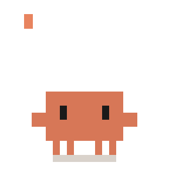 | 一边打出 `hello, world` 一边挥手，打招呼用。 |
| 2 | **思考中** Thinking | 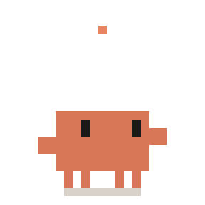 | 头顶转着 Claude Code 的 ✻ 小星星，点点点一个个冒出来，歪着头思考。 |
| 3 | **深度思考** ultrathink |  | 彩虹色的 `ultrathink` 一个个出现，它想得太用力，全身发红冒烟，最后头顶亮起一个灯泡。 |
| 4 | **计划模式** Plan Mode | 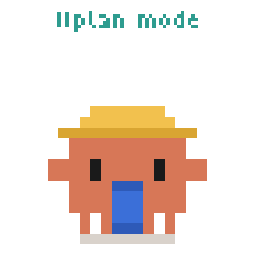 | 戴上安全帽，展开一张蓝图，先画个小房子再动手写代码。 |
| 5 | **待办清单** Todo List | 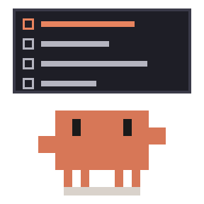 | 盯着待办清单，每一项先变橙色，再被打上勾；四项全部完成时彩纸落下。 |
| 6 | **很简单** It's Simple | 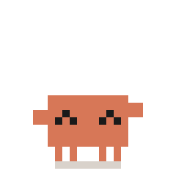 | 拽着一张标题写着 "it's simple" 的需求单，越拉越长，两边的纸堆得越来越高。 |
| 7 | **子代理** Subagents | 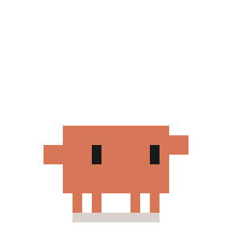 | 派出三只小小克跑出画面，它们一只只带着对勾回来，主小克欢呼。 |
| 8 | **疯狂同意** Yes, Proceed | 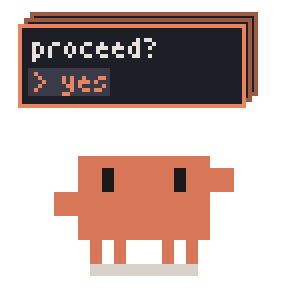 | 权限确认框一个接一个弹出来，它一直按 yes，越按越快，最后眼睛变成 > <。 |
| 9 | **批准** LGTM | 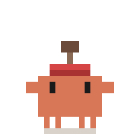 | 举起印章，啪地盖下一个歪歪的红色 LGTM，可以当「同意 / 收到 / 没问题」用。 |
| 10 | **您说得对** You're Absolutely Right! |  | `You're absolutely right!` 一行行出现，它拼命点头，身边冒星星。 |
| 11 | **上下文压缩** /compact |  | 写着 `/compact` 的铁板压下来，把它压成一张饼；弹回来开心了一下，头顶冒出一个「？」：刚才在干嘛来着？ |
| 12 | **清空上下文** /clear | 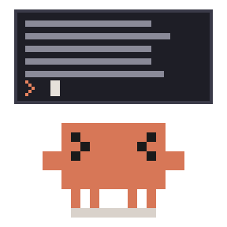 | 终端满屏文字，它眼睛都转晕了；敲下 `/clear`，全部清空，开心地冒星星。 |
| 13 | **额度用完** Usage Limit | 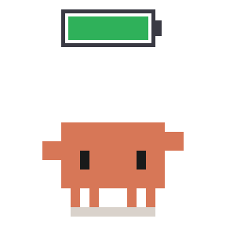 | 一边敲键盘，头顶的电池一边从绿掉到红；电量耗尽时出现 `limit reached`，它瘫成一张饼，等电池充满才弹起来。 |
| 14 | **急停** Esc | 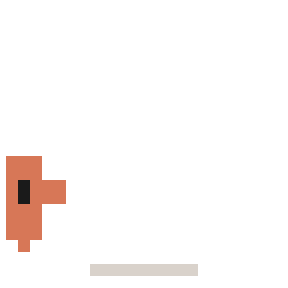 | 正全速往前冲，一个大 Esc 键砸在面前，急刹车，脸贴到键上。 |
| 15 | **封号** Banned | 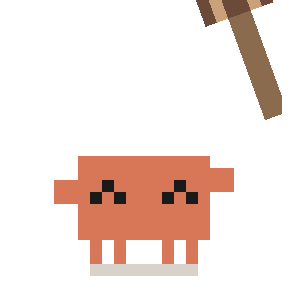 | 正开心地敲键盘，一把大锤从天而降砸下来；红色 BANNED 印章弹出，它整个变成灰色，铁栏杆落下把它关住。 |
| 16 | **克隆** git clone | 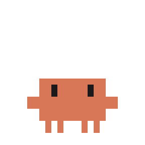 | 敲下 `git clone`，憋气发抖，分出两只小克，三只轮流蹦，再合回一只。 |
| 17 | **藏起来** git stash | 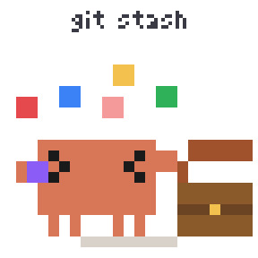 | 慌慌张张把散落的改动一股脑塞进宝箱，啪地合上盖子，然后望天吹口哨。 |
| 18 | **摘樱桃** cherry-pick | 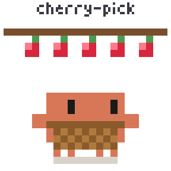 | 在一排樱桃下面挑着蹦起来，只摘了两颗放进篮子，其余的不碰。 |
| 19 | **合并冲突** Merge Conflict | 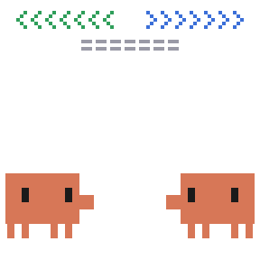 | `<<<<<<<` 和 `>>>>>>>` 下两只小克顶着脑袋互推冒火花，弹开，互相瞪。 |
| 20 | **强推** Force Push | 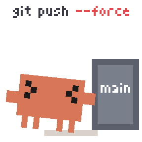 | 顶着写着 `main` 的大方块使劲推，推飞后欢呼；然后方块又被推回来，把它挤走。 |
| 21 | **甩锅** git blame | 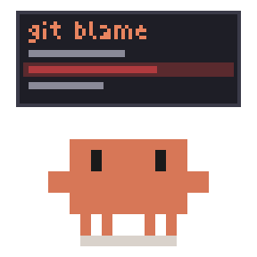 | 在 `git blame` 下气冲冲地指着出错的那行，结果作者是自己；默默放下钳子，冒着汗挪走了。 |
| 22 | **删库** rm -rf | 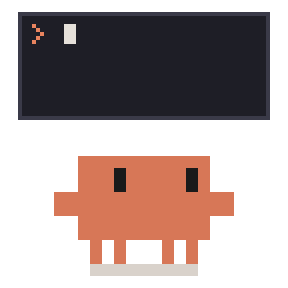 | 一个字一个字敲完 `rm -rf /`，回车，自己从脚开始被删光，只剩一双眼睛，然后从终端里重新掉出来。 |
| 23 | **头掉了** detached HEAD | 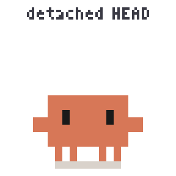 | 脑袋「啵」地分离浮在原地，身体到处乱跑找头，最后咔哒一下装回去。 |
| 24 | **找不到** 404 Not Found | 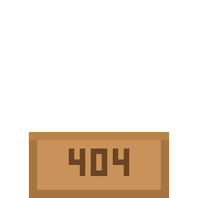 | 写着 404 的纸箱里冒出半个脑袋左右张望，发现被看到了，嗖地缩回去，留下一个「？」。 |
| 25 | **报错** Error |  | 头顶红色 Error 闪烁，抱头，然后四脚朝天翻过去，腿乱蹬、头上冒星星，再翻回来。 |
| 26 | **抓虫** Bug Hunt | 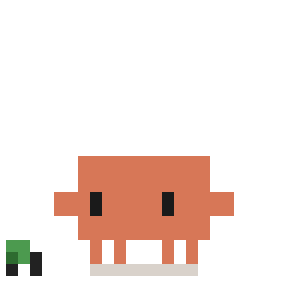 | 眼睛跟着一只小虫，起跳一屁股坐下去，正得意，结果虫从另一边溜走了。 |
| 27 | **小黄鸭调试** Rubber Duck | 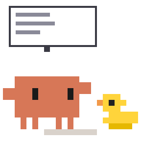 | 对着一只小黄鸭比划着讲代码，讲着讲着停下来……头顶亮起灯泡，想通了。 |
| 28 | **死循环** while(true) | 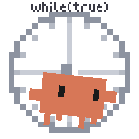 | 在仓鼠轮里狂奔，跑着跑着眼睛变成 > <，汗都甩飞了。 |
| 29 | **栈溢出** Stack Overflow | 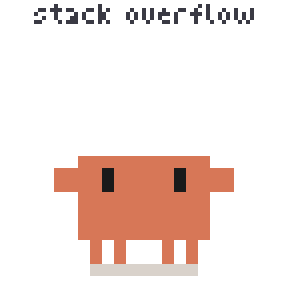 | 头顶的盘子越叠越高、越晃越厉害，最后整摞倒塌，它晕乎乎地冒星星。 |
| 30 | **内存泄漏** Memory Leak | 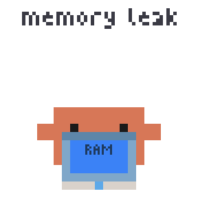 | 抱着一个写着 RAM 的罐子，漏洞一个接一个冒出来，水越漏越少，地上积起一滩水。 |
| 31 | **在我电脑上能跑** Works on My Machine | 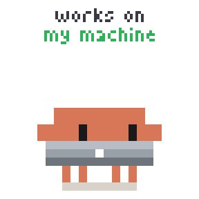 | 抱着自己的笔记本耸肩，然后抱着电脑冒爱心。 |
| 32 | **测试通过** Tests Passed | 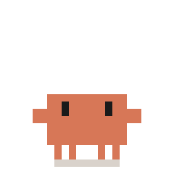 | 紧张地盯着，绿色大对勾画出来，彩纸落下，蹦蹦跳跳。 |
| 33 | **周五上线** Friday Deploy | 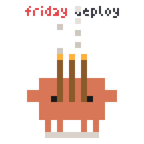 | 头顶写着 `friday deploy`，捧着三炷香闭眼连拜三下。 |
| 34 | **赶工** Deadline | 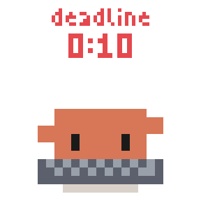 | 红色倒计时一路逼近，键盘敲到冒火；归零那一刻出现 `sent!`，整个瘫成一张饼。 |
| 35 | **加班** Overtime | 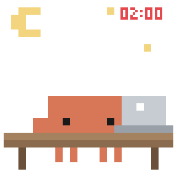 | 深夜 02:00，月亮星星，趴在桌前打瞌睡往下沉，一个激灵惊醒，又慢慢闭眼。 |
| 36 | **咖啡续命** Coffee Break | 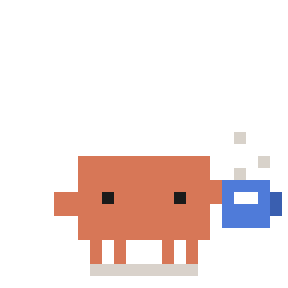 | 困得眯眼晃，端起蓝色马克杯一口闷，眼睛瞬间瞪大，满血复活。 |
| 37 | **摸鱼** Slacking Off | 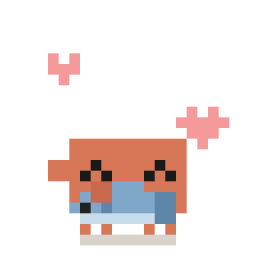 | 怀里抱着一条蓝色小鱼慢慢摸，鱼尾巴摇，冒小爱心。 |
| 38 | **下班** Clock Out | 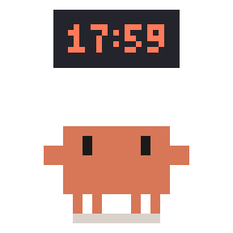 | 盯着时钟从 17:59 跳到 18:00，一溜烟冲出画面；然后时间倒回 17:59，蔫蔫地走回来。 |
| 39 | **晚安** Good Night | 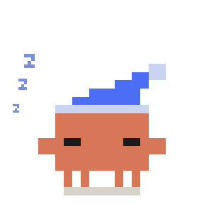 | 戴着蓝色睡帽睡觉，一串 z 慢慢飘上去。 |
| 40 | **拜拜** /exit | 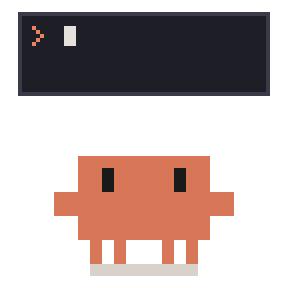 | 敲下 `/exit`，挥手告别，然后缩小钻进终端里，只留下一句 `bye!`。 |

## 桌宠主题 · Clawd Dev Life

### 动画触发时机

同一行列出多个动画时，会播放其中一个。

| 触发时机 | 动画 |
|---|---|
| 提交提示词 | Thinking、ultrathink、Plan Mode |
| 使用工具（1 个会话） | Todo List、It's Simple、Bug Hunt、while(true)、Deadline |
| 使用工具（2 个会话） | Team of Two、Merge Conflict |
| 使用工具（3 个及以上会话） | Team of Three |
| 子代理运行中 | Subagents |
| 压缩上下文 | /compact |
| 创建 worktree | git clone |
| 权限请求或提醒 | Yes, Proceed |
| 任务完成 | Tests Passed (extended)、LGTM |
| 工具调用失败 | Error |
| 没有活动 | Idle |
| 空闲时随机播放 | Slacking Off、Coffee Break、Rubber Duck、Works on My Machine、git blame、Friday Deploy、Overtime、Clock Out、Memory Leak、Stack Overflow、cherry-pick |
| 自由走动 | Walk |
| 被拖拽 | Drag |
| 双击 | 左侧播放 hello, world，右侧播放 You're Absolutely Right!；有一半概率触发 404 Not Found |
| 快速连点四下 | rm -rf、detached HEAD (extended)、Banned (extended) |
| 鼠标绕着小克转圈 | Dizzy |
| 入睡 | Yawn，随后接续 Good Night |
| 醒来 | Wake，随后接续 Coffee Break |

### 主题专属动画

以下动画只出现在主题中，或是原版表情包的变体。

| 名字 | 预览 | 小剧情 |
|---|---|---|
| **Idle** |  | 呼吸、眨眼，眼睛跟着鼠标转。 |
| **Walk** | 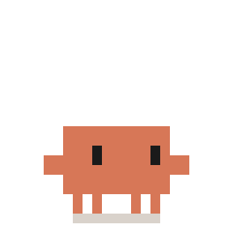 | 手脚成对迈步，一步一步往前走。 |
| **Drag** |  | 被拎着后颈晃来晃去，手舞足蹈，汗都甩飞了。 |
| **Tests Passed (extended)** |  | 原表情包的加长版，多落下一轮彩纸。 |
| **detached HEAD (extended)** |  | 加长版，脑袋装回去后，松了口气蹦起来。 |
| **Banned (extended)** |  | 加长版，整段反应里牌子一直闪，眼泪一直掉。 |
| **Dizzy** |  | Usage Limit 的变体：被鼠标绕晕，眼睛转圈，身体跟着摇晃，电池慢慢耗尽。 |
| **Yawn** |  | 强撑着不闭眼，最后还是合上了；睡帽落下，z 开始飘起来。后面接续 Good Night。 |
| **Wake** |  | 眼睛睁开一条缝，睡帽飘走，马克杯滑进画面。后面接续 Coffee Break。 |
| **Team of Two** |  | 两只小克并排工作：一只写代码，一只跑测试，测试失败时慌成一团。 |
| **Team of Three** |  | 第三只小克站到屏幕上，边喝咖啡边看另外两只干活。 |

### 未用于主题的表情

/clear、Esc、git stash、Force Push 和 /exit 目前没有出现在主题中，可能是暂无合适的触发时机，或实装效果欠佳。
