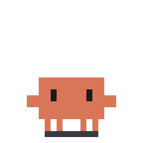
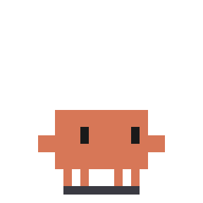

# Clawd Dev Life (Dark)

[English](README.md) | 简体中文

[clawd-on-desk](https://github.com/rullerzhou-afk/clawd-on-desk) 主题：让 Clawd 演出开发者的日常。

- **作者**：alwinecor
- **版本**：1.0.0
- **主题 ID**：`clawd-dev-life-dark`
- **源仓库**：<https://github.com/alwinecor/clawd-stickers>

## 安装

把本文件夹复制到 clawd-on-desk 的主题目录，然后在 **Settings... → Theme** 中选择本主题。

| 系统 | 主题目录 |
| --- | --- |
| Windows | `%APPDATA%/clawd-on-desk/themes/` |
| macOS | `~/Library/Application Support/clawd-on-desk/themes/` |
| Linux | `~/.config/clawd-on-desk/themes/` |

## 支持的能力

- 全部 agent 状态，包括思考、工作、子代理、压缩上下文、报错和完整入睡流程等
- 2 个会话与 3 个及以上会话的专用动画，含多只 Clawd
- 待机时眼睛跟随、随机待机动画、走动、拖拽和点击反应

## 已知限制

- 不支持迷你模式。
- 已关闭桌宠染色。
- 无专属音效。
- 已在 Windows 上的 clawd-on-desk 1.5.0 测试，macOS 和 Linux 尚未测试。

## 全部动画

本主题共 47 个动画。同一时机列出多个动画时，会播放其中一个。大部分动画来自[克码人生表情包](https://github.com/alwinecor/clawd-stickers/blob/main/dev-life/README.zh-CN.md)，具体内容说明请见那里。

### 工作

<table>
<tr><th>触发时机</th><th colspan="4">动画</th></tr>
<tr>
<td>提交提示词</td>
<td align="center"> <b>思考中</b> Thinking</td>
<td align="center"> <b>深度思考</b> ultrathink</td>
<td align="center"> <b>计划模式</b> Plan Mode</td>
<td></td>
</tr>
<tr>
<td rowspan="2">使用工具（1 个会话）</td>
<td align="center"> <b>待办清单</b> Todo List</td>
<td align="center"> <b>很简单</b> It's Simple</td>
<td align="center"> <b>抓虫</b> Bug Hunt</td>
<td align="center"> <b>死循环</b> while(true)</td>
</tr>
<tr>
<td align="center"> <b>赶工</b> Deadline</td>
<td colspan="3"></td>
</tr>
<tr>
<td>使用工具（2 个会话）</td>
<td align="center"> <b>两人组</b> Team of Two</td>
<td align="center"> <b>合并冲突</b> Merge Conflict</td>
<td colspan="2">两人组里，两只小克并排工作：一只写代码，一只跑测试，测试失败时慌成一团。</td>
</tr>
<tr>
<td>使用工具（3 个及以上会话）</td>
<td align="center"> <b>三人组</b> Team of Three</td>
<td colspan="3">第三只小克站到屏幕上，边喝咖啡边看另外两只干活。</td>
</tr>
<tr>
<td>子代理运行中</td>
<td align="center"> <b>子代理</b> Subagents</td>
<td colspan="3"></td>
</tr>
<tr>
<td>压缩上下文</td>
<td align="center"> <b>上下文压缩</b> /compact</td>
<td colspan="3"></td>
</tr>
<tr>
<td>创建 worktree</td>
<td align="center"> <b>克隆</b> git clone</td>
<td colspan="3"></td>
</tr>
<tr>
<td>权限请求或提醒</td>
<td align="center"> <b>疯狂同意</b> Yes, Proceed</td>
<td colspan="3"></td>
</tr>
<tr>
<td>任务完成</td>
<td align="center"> <b>测试通过（加长版）</b> Tests Passed (extended)</td>
<td align="center"> <b>批准</b> LGTM</td>
<td colspan="2"></td>
</tr>
<tr>
<td>工具调用失败</td>
<td align="center"> <b>报错</b> Error</td>
<td colspan="3"></td>
</tr>
</table>

### 待机

<table>
<tr><th>触发时机</th><th colspan="4">动画</th></tr>
<tr>
<td>没有活动</td>
<td align="center"> <b>待机</b> Idle</td>
<td colspan="3"></td>
</tr>
<tr>
<td>自由走动</td>
<td align="center"> <b>走动</b> Walk</td>
<td colspan="3"></td>
</tr>
<tr>
<td rowspan="4">空闲时随机播放</td>
<td align="center"> <b>摸鱼</b> Slacking Off</td>
<td align="center"> <b>咖啡续命</b> Coffee Break</td>
<td align="center"> <b>小黄鸭调试</b> Rubber Duck</td>
<td align="center"> <b>在我电脑上能跑</b> Works on My Machine</td>
</tr>
<tr>
<td align="center"> <b>甩锅</b> git blame</td>
<td align="center"> <b>周五上线</b> Friday Deploy</td>
<td align="center"> <b>加班</b> Overtime</td>
<td align="center"> <b>下班</b> Clock Out</td>
</tr>
<tr>
<td align="center"> <b>内存泄漏</b> Memory Leak</td>
<td align="center"> <b>栈溢出</b> Stack Overflow</td>
<td align="center"> <b>摘樱桃</b> cherry-pick</td>
<td align="center"> <b>急停</b> Esc</td>
</tr>
<tr>
<td align="center"> <b>强推</b> Force Push</td>
<td align="center"> <b>藏起来</b> git stash</td>
<td align="center"> <b>清空上下文</b> /clear</td>
<td align="center"> <b>拜拜（加长版）</b> /exit (extended)</td>
</tr>
</table>

### 互动

<table>
<tr><th>触发时机</th><th colspan="4">动画</th></tr>
<tr>
<td>被拖拽</td>
<td align="center"> <b>拖拽</b> Drag</td>
<td colspan="3"></td>
</tr>
<tr>
<td>双击</td>
<td align="center"> <b>你好，世界</b> hello, world 点击左侧。</td>
<td align="center"> <b>您说得对</b> You're Absolutely Right! 点击右侧。</td>
<td align="center"> <b>找不到</b> 404 Not Found 有一半概率触发。</td>
<td></td>
</tr>
<tr>
<td>快速连点四下</td>
<td align="center"> <b>删库</b> rm -rf</td>
<td align="center"> <b>头掉了（加长版）</b> detached HEAD (extended)</td>
<td align="center"> <b>封号（加长版）</b> Banned (extended)</td>
<td></td>
</tr>
<tr>
<td>鼠标绕着小克转圈</td>
<td align="center"> <b>晕眩</b> Dizzy</td>
<td colspan="3"></td>
</tr>
</table>

### 睡眠

<table>
<tr><th>触发时机</th><th colspan="4">动画</th></tr>
<tr>
<td>入睡</td>
<td align="center"> <b>打哈欠</b> Yawn</td>
<td colspan="3"></td>
</tr>
<tr>
<td>睡着</td>
<td align="center"> <b>晚安</b> Good Night</td>
<td colspan="3"></td>
</tr>
<tr>
<td>醒来</td>
<td align="center"> <b>醒来</b> Wake</td>
<td colspan="3"></td>
</tr>
</table>

## 许可

见 [LICENSE](LICENSE)。本主题是非官方粉丝作品，与 Anthropic 无关联，也未获得其背书。
