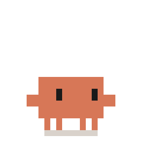

# Clawd Dev Life

English | [简体中文](README.zh-CN.md)

A [clawd-on-desk](https://github.com/rullerzhou-afk/clawd-on-desk) theme in which Clawd acts out everyday developer life.

- **Author**: alwinecor
- **Version**: 1.0.0
- **Theme ID**: `clawd-dev-life`
- **Source**: <https://github.com/alwinecor/clawd-stickers>

## Install

In clawd-on-desk 1.5.0 or later, download this theme from the community themes under **Settings... → Theme**.

To install it by hand, copy this folder into your clawd-on-desk themes folder, then pick the theme under **Settings... → Theme**.

| System | Themes folder |
| --- | --- |
| Windows | `%APPDATA%/clawd-on-desk/themes/` |
| macOS | `~/Library/Application Support/clawd-on-desk/themes/` |
| Linux | `~/.config/clawd-on-desk/themes/` |

## Supports

- Every agent state, including thinking, working, subagents, context compaction, errors, the full sleep sequence and more
- Separate animations for two and for three or more active sessions, with several Clawds on screen
- Eye tracking while idle, random idle animations, roaming, dragging and click reactions

## Known limitations

- Mini mode is not supported.
- Pet tint is turned off.
- No custom sound effects.
- Tested with clawd-on-desk 1.5.0 on Windows and macOS. Linux is untested.

## Animations

The theme has 47 animations. Where a moment lists several, one of them plays. Most come from the [Dev Life stickers](https://github.com/alwinecor/clawd-stickers/blob/main/dev-life/README.md), where you can read more about each one.

### Working

| When | Preview | Animation |
| --- | --- | --- |
| A prompt is submitted |  | **Thinking** |
| |  | **ultrathink** |
| |  | **Plan Mode** |
| Using tools, one session |  | **Todo List** |
| |  | **It's Simple** |
| |  | **Bug Hunt** |
| |  | **while(true)** |
| |  | **Deadline** |
| Using tools, two sessions |  | **Team of Two** |
| |  | **Merge Conflict** |
| Using tools, three or more sessions |  | **Team of Three** |
| A subagent is active |  | **Subagents** |
| Compacting context |  | **/compact** |
| Creating a worktree |  | **git clone** |
| Permission request or alert |  | **Yes, Proceed** |
| Task completed |  | **Tests Passed (extended)** |
| |  | **LGTM** |
| Tool failure |  | **Error** |

### Idle

| When | Preview | Animation |
| --- | --- | --- |
| No activity |  | **Idle** |
| Free roam |  | **Walk** |
| Random idle scene |  | **Slacking Off** |
| |  | **Coffee Break** |
| |  | **Rubber Duck** |
| |  | **Works on My Machine** |
| |  | **git blame** |
| |  | **Friday Deploy** |
| |  | **Overtime** |
| |  | **Clock Out** |
| |  | **Memory Leak** |
| |  | **Stack Overflow** |
| |  | **cherry-pick** |
| |  | **Esc** |
| |  | **Force Push** |
| |  | **git stash** |
| |  | **/clear** |
| |  | **/exit (extended)** |

### Interaction

| When | Preview | Animation |
| --- | --- | --- |
| Dragged |  | **Drag** |
| Double-click |  | **hello, world** Left side. |
| |  | **You're Absolutely Right!** Right side. |
| |  | **404 Not Found** A 50% chance. |
| Four rapid clicks |  | **rm -rf** |
| |  | **detached HEAD (extended)** |
| |  | **Banned (extended)** |
| Mouse circled around Clawd |  | **Dizzy** |

### Sleep

| When | Preview | Animation |
| --- | --- | --- |
| Falling asleep |  | **Yawn** |
| Asleep |  | **Good Night** |
| Waking up |  | **Wake** |

## License

See [LICENSE](LICENSE). This is an unofficial fan theme, not affiliated with or endorsed by Anthropic.
